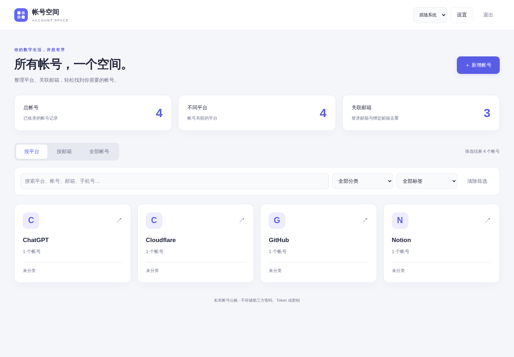
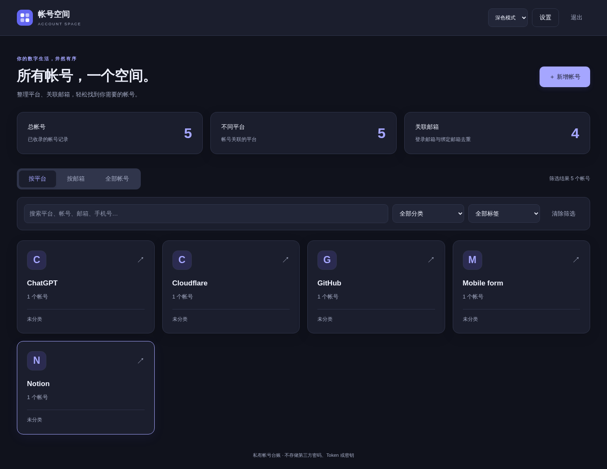
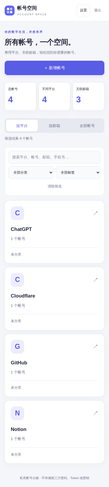

# 帐号空间 · Account Space

个人帐号信息台账：按平台整理多个帐号，按邮箱串联不同平台，或直接搜索全部帐号。**不是密码管理器，请勿保存第三方密码、Token 或 API Key。** 简体中文、单管理员、Cloudflare Workers + D1，正常个人使用不依赖付费服务。

## 已实现

- 平台 / 邮箱 / 全部帐号三视图，完整数据统计，全字段搜索、分类与标签筛选。
- 帐号新增、详情、编辑、复制、二次确认删除；允许只有邮箱或手机号，重复只提示、不强制禁止。
- 平台默认网址继承与帐号覆盖，平台/分类管理，标签全局重命名、合并与删除。
- JSON 完整备份与原子全量恢复，CSV 预览、重复处理、追加导入、安全导出。
- 浅色 / 深色 / 跟随系统主题；375px 手机、平板、桌面响应式布局。
- Secrets 管理员登录、D1 服务端会话、密码轮换使旧会话失效、登录限流、同源写入检查、CSP 和 no-store。
- 无外部字体、CDN、追踪、第三方图标请求或浏览器个人数据持久化；只有主题保存在 localStorage。

## 实际运行截图

以下为本地 Chromium + Wrangler + D1 实测，帐号全部为测试时临时创建的虚构数据，**新实例不会预置帐号**。





## 部署到 Cloudflare

**模板配置已完成，本次没有连接 Cloudflare 帐号或发布远程代码，真实一键部署尚未验收。** 下方地址来自当前 Git remote：`https://github.com/svlic/cfmark`。只有所有者将本实现推送到该地址且仓库公开后，其他人才能使用官方按钮；未满足前它只是待启用的模板入口，不代表已部署成功。不会擅自公开仓库或决定开源协议。

[](https://deploy.workers.cloudflare.com/?url=https://github.com/svlic/cfmark)

最短流程：

1. 所有者确认仓库地址/公开性，推送代码（若更换地址，更新本页按钮链接）。
2. 点击官方按钮，在 Cloudflare 授权 GitHub，选择 Free，设置唯一 Worker 名和独立数据库名，创建 D1 `DB`。
3. 在 Cloudflare 安全输入 `ADMIN_USERNAME`、`ADMIN_PASSWORD`。没有默认帐号密码；密码最低 8 字符、最高 1024 UTF-8 字节，建议使用更长的随机密码，不复用其他网站的密码。不把真实凭据发到聊天或提交到仓库。
4. 接受部署命令 `npm run deploy`；平台自动配置资源后，脚本先检查、迁移，再发布。首次打开 workers.dev，用刚设置的凭据登录。
5. 在 Workers Builds 禁用非生产分支部署，并按 [云端验收步骤](docs/deployment.md#云端验收) 核查限流、第二实例独立性和 100 条导入。

仅自己使用可在 Cloudflare Dashboard 连接私有 GitHub 仓库，不必公开；需先在 Dashboard 创建独立 D1 并绑定/记录 ID，再设置 Secrets 与 Builds。完整操作、CLI 备选、自有域名、关闭 workers.dev、升级/回滚见 [部署文档](docs/deployment.md)。

## 本地运行

Windows/macOS/Linux 安装 Node.js 22.12+（建议最新 Node 22 LTS）和 Git。克隆仓库后在项目目录运行：

```sh
npm ci
```

用文件管理器或编辑器把 `.dev.vars.example` 复制为 `.dev.vars`，仅在本机填写用户名和随机强密码（不提供可用默认值）。管理员用户名不要含首尾空格。`.dev.vars` 已忽略；不要改 example 来保存真实凭据。

```sh
npm run db:local
npm run dev
```

浏览器在开发机器打开 `http://localhost:8787`。开发会话仅适配 localhost，不要把 Wrangler 开发端口暴露到公网。生产必须走 HTTPS。关闭终端停止本地开发服务；数据保存在本机 `.wrangler`，不会触碰远程 D1。

## 检查与测试

```sh
npm run check
npm run db:local
npx playwright install --with-deps chromium
npm run test:e2e
```

`check` 执行后端与浏览器测试代码的严格类型检查、Workers runtime 集成测试和 Worker dry-run 打包；不是远程部署。`test:e2e` 在 loopback 8788 启动独立本地数据库和明确标注的合成测试凭据，不读取/修改生产数据。首次 Linux 浏览器安装可能需要系统包管理器权限；Windows/macOS 由 Playwright 下载浏览器。

结果与覆盖范围见 [验收报告](docs/acceptance.md)。本地模拟器测试不代表真实 Workers Free 10ms CPU 下的性能已获验证。

## 数据与维护

- [备份格式、CSV 模板与恢复边界](docs/backup.md)：JSON 是无损备份；CSV 对危险公式前缀加单引号，回导不自动去除，Excel 可能改写手机号。
- [部署与运维](docs/deployment.md)：升级前备份，本地测试后发布；克隆不会自动跟随上游更新。
- [架构与约定](docs/architecture.md)：邮箱比较规则、重复逻辑、后写覆盖策略与认证边界。
- [安全说明](SECURITY.md)：请启用 GitHub/Cloudflare 二次验证，保护 D1 与导出文件。D1 不提供本应用层面的端到端加密。

许可证尚未由所有者决定，因此当前不附加 LICENSE；公开模板发布前请明确授权方式。
