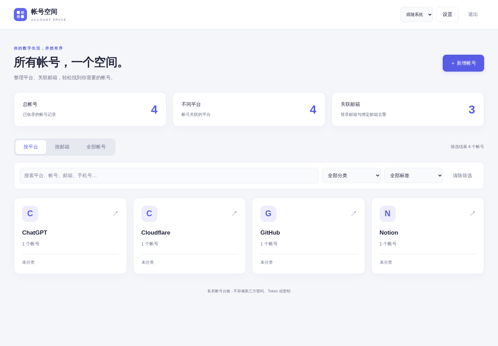
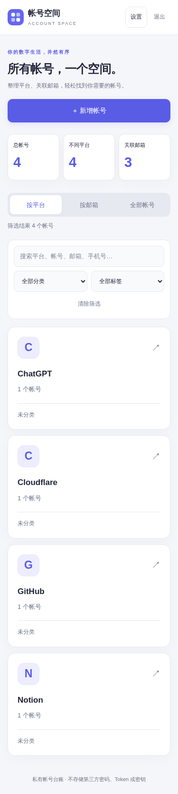
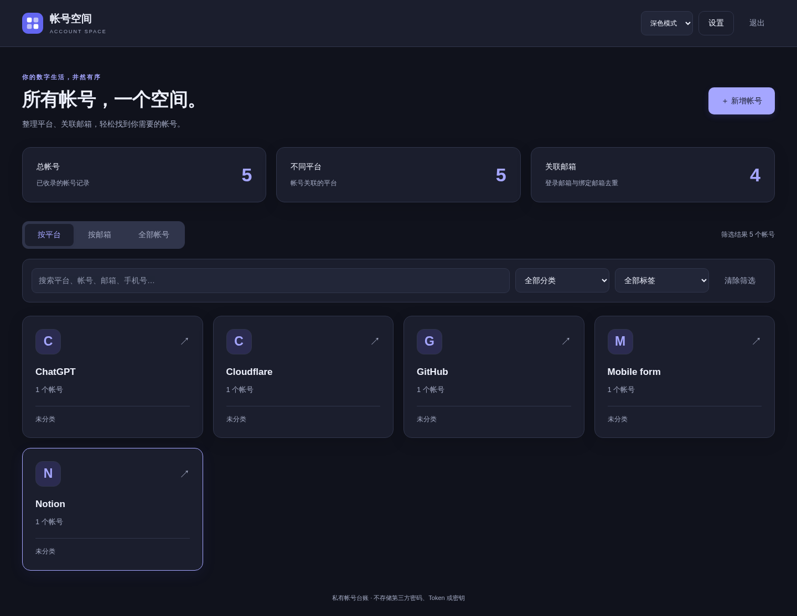
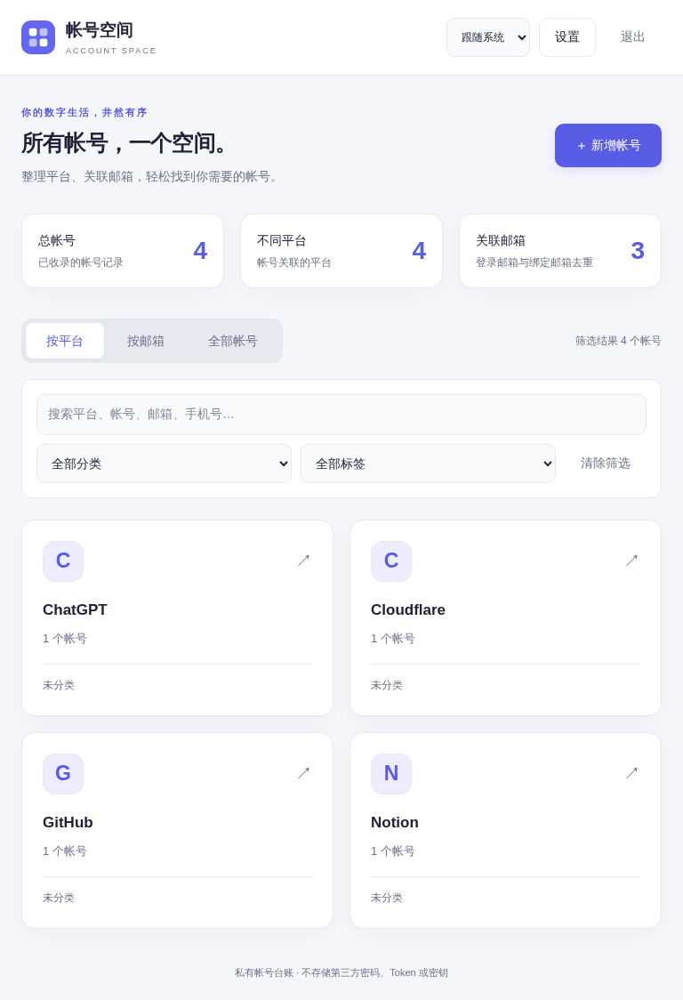
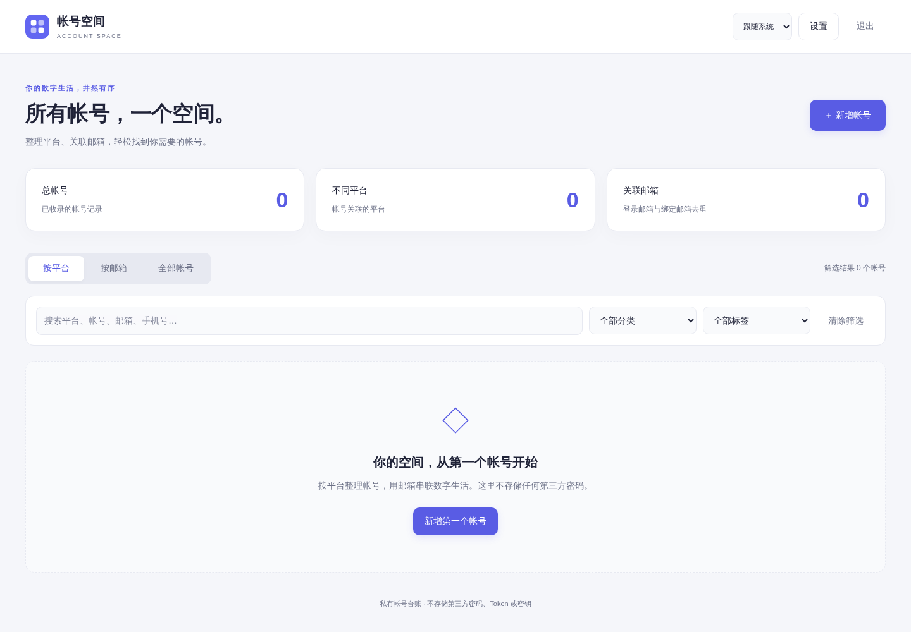
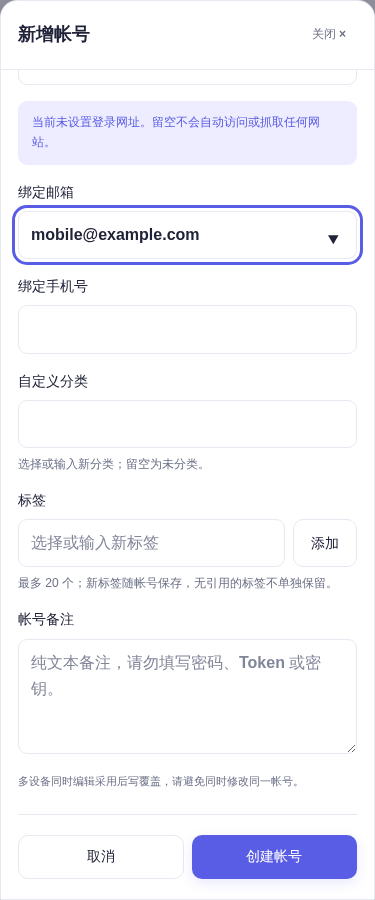

# Account Space 本地验收记录

P0 功能已实现并通过本地自动化和浏览器检查；Cloudflare 实际部署、Free CPU 与域名隔离尚未验证。代码与文档目前仅在工作区，未提交、推送、公开仓库或部署。验收日期：2026-11-25。

## 实际执行结果

| 命令或检查 | 结果 |
|---|---|
| `npm ci` | 通过，依赖版本由锁文件固定 |
| `npm run check` | 通过：严格 TypeScript 检查、19 项测试、Worker dry-run |
| `npm run db:local` | 初次迁移通过；重复执行无待迁移项 |
| `npm run test:e2e` | 4 项通过，最近一次 38.9 秒 |
| `npm audit` | 0 个已知漏洞 |
| Worker dry-run | 124.93 KiB，gzip 33.53 KiB；没有远程发布 |
| Chromium 截图检查 | 桌面 1440px、平板 768px、手机 375px、空态、深色、手机表单 |

集成测试通过真实 workerd/Miniflare 与本地 D1 执行，不用内存对象替代数据库。浏览器测试启动独立的 loopback 测试服务，使用虚构凭据和帐号，不连接线上数据库。截图是实际运行结果，不是设计稿。开发命令也仅监听 loopback，不提供公网开发入口。

## 需求对照与边界

| 任务书 ID | 本地证据与结果 |
|---|---|
| A01–A03 | 自动化通过：正确/错误/缺失凭据、限流拒绝、伪造 Cookie、私有 API、备份、未知 API、直接 HTML 访问控制；真实 Cloudflare 节点限流待云端验证 |
| A04 | 自动化通过：模拟 HTTPS 下生产 Cookie 属性、过期、注销、凭据轮换撤销会话；真实 HTTPS 待验证 |
| A05 | 自动化通过：跨源/缺 Origin 拒绝、危险 URL 拒绝、SQL 输入当作数据；浏览器 XSS 内容按纯文本显示 |
| A06 | no-store/CSP 自动验证；源码审查无应用敏感日志，数据库内部异常不透传；Cloudflare 平台日志设置待云端核查 |
| B01–B05 | 自动化通过：同平台多帐号、跨平台同邮箱、邮箱/手机号单独作身份、空身份拒绝 |
| B06–B08 | 视图逻辑测试通过：邮箱并集、单条去重、双角色、不同邮箱双组、大小写/空格规则；加号和点别名不合并 |
| B09–B10 | API 与浏览器通过：重复提示/确认、编辑自身、CRUD/复制、网址默认继承与覆盖、视图刷新 |
| B11 | API 通过：基础资料、引用保护、分类删除回退、标签全局重命名/合并/删除；浏览器平台管理流程通过 |
| B12 | 逻辑测试与浏览器通过：三视图、搜索、分类/标签组合筛选、清除与手机号搜索 |
| C01 | 自动化通过：100 条 JSON 导出/恢复及空平台/分类完整保留，恢复不改会话，备份不含认证资料 |
| C02 | 自动化通过：坏 JSON、错误引用、版本不支持被拒绝；注入后续 SQL 失败验证 D1 batch 全事务回滚 |
| C03 | 自动化通过：BOM、引号、逗号、多行、重复默认跳过/明确保留、公式前缀安全导出；浏览器下载与恢复通过 |
| C04 | 自动化通过：1 MiB 文件限制、100/500 条 CSV 导入、501 条拒绝；提交重新校验，错误无部分写入；导出超过 500 条不截断 |
| U01 | 浏览器通过且截图已查看：桌面、平板、375px 手机无横向溢出，浅/深色；手机表单滚动后实际保存成功 |
| U02 | 浏览器通过：空态、网络错误保留输入、会话过期清空并跳转；代码有提交锁。重复点击时序未单独做压力测试 |
| D01 | 本地通过：安装、检查、打包、迁移、登录、CRUD、导入恢复 |
| D02–D05 | **未验证**：未授权/执行云端部署；可操作步骤和预期结果见 [部署文档](deployment.md#云端验收) |

自动化入口为 `tests/api.test.ts`、`tests/views.test.js`、`tests/browser/app.spec.ts`。上述覆盖是本地验证，不声称全部浏览器、剪贴板权限、真实多节点行为或线上免费额度已通过。

## 关键设计选择

- 一个 Worker 服务静态页面与同源 API，D1 保存业务数据和服务端会话，无外部前端资源。私有页面和 API 都鉴权，浏览器仅持久化主题偏好。
- 管理员来自两项 Secrets，没有默认密码。D1 仅保存绑定当前凭据的会话 HMAC；凭据轮换使旧 Cookie 失效，不需要保存可离线猜测的密码验证值。
- JSON 恢复先完整校验，再在一个 D1 batch 中替换业务数据；不删除 sessions。每表一个 JSON SQL 参数，避免逐记录 SQL 超过免费查询/绑定参数边界。真实 Free CPU 仍需实测。
- 邮箱分组取登录邮箱和绑定邮箱的并集，单条在同组只计一次。手机号可搜索但不另设分组。多设备编辑采用后写覆盖，未实现可选的乐观并发控制。
- JSON 是无损备份；CSV 为表格交换格式，公式前缀被加单引号且回导不自动剥除，网址导出使用生效值，详见 [备份说明](backup.md)。

## 所有者上线前的最短步骤

1. 审查代码，决定提交/推送与仓库公开性；README 按钮地址已取自现有 remote `https://github.com/svlic/cfmark`，未擅自设置 LICENSE。
2. 使用官方按钮或私有仓库备选，为实例建立独立 Worker/D1，选择 Free；在安全界面设置 `ADMIN_USERNAME`、`ADMIN_PASSWORD`，不要向聊天发送真实凭据。
3. 确认部署命令 `npm run deploy`，检查资源初始化、迁移与发布日志；代码中无真实数据库 ID。
4. 完成 D02–D05 云端验收，特别是连续登录限流、第二实例隔离、100 条真实 Free 导入/恢复和预览禁用。未完成前不宣称“一键部署已实测”。

## 实测截图

截图中全部是虚构测试数据，新实例没有示例帐号。

